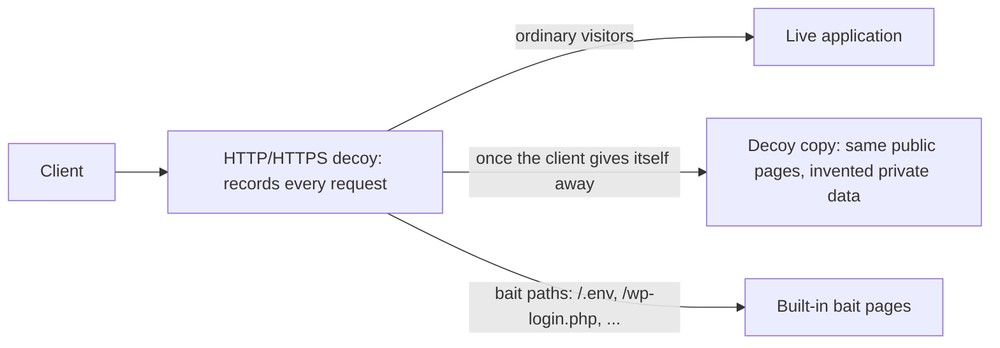
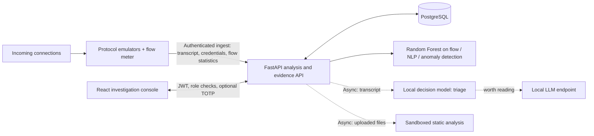

<div align="center">

# HoneySentinel AI

### Capture the interaction. Understand the behavior. Follow the evidence.

An AI-assisted honeypot platform with protocol emulation, encrypted session evidence,
and a workspace for investigating suspicious activity.

**[Quick start](#quick-start) · [Self-hosted deployment](#self-hosted-deployment) · [What is validated](#what-is-and-is-not-yet-validated) · [Architecture](#architecture) · [Development](#development)**

[](https://github.com/mandoof1/honeypot-ui/actions/workflows/ci.yml)
&nbsp;Version 1.0.0 · MIT

</div>


*Desktop preview using synthetic test data. The screenshot demonstrates the interface, not live threat activity.*

## About

HoneySentinel is a honeypot and an investigation workspace in one. The engine
emulates SSH, Telnet, FTP, HTTP and HTTPS, lets an attacker in, and records
what they do — commands, credentials, uploaded files and per-connection flow
statistics — as encrypted evidence. The console is where you read that
evidence: search and filter sessions, follow a transcript, see the ATT&CK
techniques, and export the matches to a SIEM or threat-intel format.

What makes it more than a logger is a **layered analysis pipeline that runs
entirely on the operator's own machine** — no session text ever leaves the
deployment:

1. **A Random Forest** on each connection's flow statistics, inside the
   200 ms ingest budget.
2. **Signature rules** over the recorded commands and web requests — brute
   force, web-exploitation patterns, uploads, scanner probes, diversion —
   which carry the verdict where flow features fall short.
3. **A decision model** (Kev, a Jev-style model served locally through
   llama.cpp) that triages the sessions the rules queue for the slow model,
   not every session: attack category, severity and whether a human or a bot
   drove it, in a median of about 16 s on the stored web sessions measured
   so far. It decides which of those sessions are worth the slow model, and
   afterwards checks each ATT&CK technique the slow model named against the
   transcript.
4. **A fine-tuned language model** ([Wolfram](https://github.com/mandoof1/wolfram))
   that reads the worthwhile transcripts for intent, objectives, techniques and
   indicators — its model card, weights and GGUF live in that repo.

A website can also sit *behind* the decoys, with attackers quietly diverted to
a sacrificial copy while real visitors keep reaching the live site. Everything
is built to be self-hosted, with every container firewalled against opening a
connection of its own.

**Where it stands.** Version 1.0.0 is the hardening pass before the system's
first exposure to the internet. It has not been exposed yet: everything it
has recorded so far is the team's own controlled test traffic, and every
evaluation figure in this repository comes from a public dataset, synthetic
transcripts or that test traffic. See
[what is and is not yet validated](#what-is-and-is-not-yet-validated).

## What you can do

| Workflow | Capabilities |
|---|---|
| **Capture** | SSH, Telnet, FTP, HTTP and HTTPS emulators record interactions, attempted credentials (shell, FTP, web login forms and HTTP Basic auth), files attackers upload, and each connection's flow statistics. Passive mode records without answering, on every protocol. |
| **Investigate** | Search sessions, filter by protocol and time, inspect and replay transcripts (shell commands, FTP commands and HTTP requests with their bodies), review ATT&CK mappings on a matrix and export them for ATT&CK Navigator, follow trends, and read the audit log. |
| **Understand** | A Random Forest trained on CIC-IDS2017, signature rules for web attacks, brute force and uploads, command analysis, research-scanner attribution, and optional local-model enrichment: a decision model triages the sessions the rules queue and a fine-tuned LLM analyses the ones worth it. Anomaly scoring and behavioural clustering are wired in but not yet meaningful: the anomaly model is a synthetic bootstrap and the clusters have never been fitted on captured sessions. |
| **Protect a website** | Put a real web application behind the HTTP/HTTPS decoys. Every request is recorded, card numbers masked, and a client that gives itself away is answered by a decoy copy of the site from then on, while everyone else keeps reaching the live one. |
| **Reverse-engineer** | Uploaded files are analysed statically — never run — for type, capabilities, embedded indicators, and a malware-family hint. |
| **Respond** | Triage alerts, manage nodes, review indicators, and control the honeypot through role-restricted actions. |
| **Share** | Copy an investigation link or export matching sessions as CSV, JSON, CEF, or STIX. |
| **Trace** | Captured evidence is encrypted at rest; privileged operations and evidence access are audit-logged where implemented. |
| **Secure access** | Role-based accounts, with optional TOTP two-factor sign-in that each user enrols from Settings by scanning a QR code. |

## Quick start

For the complete local stack, install **Docker Engine with Compose v2**, **Git**, and **Python 3**.
Docker builds the application dependencies for you.

```bash
git clone https://github.com/mandoof1/honeypot-ui.git
cd honeypot-ui
./start.sh
```

The startup script creates `.env` when absent and generates separate signing,
encryption, and ingest secrets. Compose starts PostgreSQL, the API, frontend, and engine.
The local Compose configuration enables demo seeding for an empty database.

| Service | Local address |
|---|---|
| Dashboard | http://localhost:5173 |
| Interactive API documentation | http://localhost:8000/docs |
| API health | http://localhost:8000/health |
| SSH / FTP / Telnet emulation | `localhost:2222` / `localhost:2121` / `localhost:2323` |
| HTTP / HTTPS emulation | http://localhost:8080 / https://localhost:8443 |

Retrieve the generated demo admin credentials from the backend startup log:

```bash
docker compose logs backend
```

Keep those credentials private. To stop the stack while retaining its named volumes:

```bash
./stop.sh
```

**Exposure matters:** this local stack publishes everything (the API, the
dashboard and the emulated services) on `127.0.0.1` only, loads demo data, and
its engine can still open outbound connections. Do not expose it. For a
deployment that faces the internet, use [the self-hosted deployment](#self-hosted-deployment),
where the host firewall stops every container from opening a connection.

## Self-hosted deployment

[`deploy/server/`](deploy/server/README.md) runs the whole system on one Linux machine:
database, API, dashboard and engine. This is how the project's own server runs it.

```bash
sudo git clone https://github.com/mandoof1/honeypot-ui.git /opt/honeysentinel
sudo bash /opt/honeysentinel/deploy/server/install.sh
```

The installer is idempotent, and sets up:

- **Secrets and transport.** Random secrets in a root-only `.env`, one ingest
  token per engine, and a TLS certificate that Postgres requires for every
  connection.
- **Containment.** Engines can reach one thing, an ingest service that serves
  only the engine-facing routes; the dashboard API is on no network they can
  use. A host firewall, loaded before Docker starts and re-checked every five
  minutes, lets every container answer connections and none open one, to the
  host or beyond. Every service runs without capabilities on a read-only root.
- **Verification.** Before it finishes, the installer checks that every
  container was built from the same git revision, that the networks are the
  ones the firewall expects, and, by connecting out from inside the engines,
  that they are contained. It exits non-zero otherwise.
- **Throughput.** A separate four-worker `ingest` service analyses sessions, so a
  burst does not queue behind the dashboard's API.
- **Operations.** Nightly backups (encrypted and copied off the machine when
  configured), a host heartbeat for an external dead man's switch, the
  dashboard served over Tailscale HTTPS, and, when a website sits behind the
  decoys, a nightly reset of its decoy copy.
- **Accounts.** An administrator account is created directly, its password
  shown once. The demo seed is never used, so no synthetic session sits beside
  captured traffic.

Scripts beside it cover the rest of the lifecycle:

| Script | Does |
|---|---|
| `honeysentinel-egress.sh` | The firewall: `check` it, `probe` it from inside the engines, show its counters |
| `train-model.sh` | Fetch and verify CIC-IDS2017, train the classifier with tuning, install it and restart the API |
| `fetch-decider.sh` | Download and checksum the decision model (Kev-4B, Apache-2.0) into `state/models`, then `install.sh` turns on triage |
| `controlled-test.sh` | End-to-end check against a throwaway engine named `controlled-test-node`, so test traffic never mixes with real captures |
| `stress-test.sh` | The NFR-2 / TC13 load test: N concurrent sessions, then the latency measured for each |
| `backup.sh`, `restore.sh`, `restore-drill.sh` | The nightly backup on demand, a restore, and a rehearsal of one against a scratch database |
| `host-heartbeat.sh` | The host-level health check behind the dead man's switch |
| `node_tokens.py` | Issue and revoke the ingest token of a remote sensor |
| `reset-shop.sh` | The nightly website job, on demand: back up the live copy, regenerate the decoy copy |

Before any port is forwarded to it, follow the
[exposure runbook](docs/EXPOSURE_RUNBOOK.md). To put a decoy on a separate
public address instead, use the [sensor kit](deploy/node/README.md).

## What is and is not yet validated

Stated plainly, because a honeypot's numbers are easy to overstate.

| | Status |
|---|---|
| **Containment** | The firewall rules are tested with real connections in a model of the deployment's networks (`deploy/server/tests/egress-netns-test.sh`, 44 checks) and the installer probes the real thing on every run. Installed on the reference server on 11 November 2026, where the installer's probe passed: from inside each engine, the ingest endpoint and nothing else. |
| **Capture pipeline** | Exercised end to end by `controlled-test.sh`, with the team's own traffic. **No internet attack has been recorded.** |
| **Flow classifier** | 0.9967 accuracy on a random per-flow split of CIC-IDS2017. On the deployment it labelled all five controlled attack sessions benign. **Not validated for honeypot traffic.** |
| **Rules** | Carry the verdict where the flow model does not. Measured only on synthetic transcripts written around the same patterns. |
| **Decision model** | AUC 0.983 on technique checks, from 24 synthetic transcripts with question wording and threshold tuned on the same set (0.957 before tuning). Triage accuracy is uninformative (labels 23 to 1). **Not validated on captured sessions.** |
| **Language model** | No accuracy measurement in this repository; see its own [model card](https://github.com/mandoof1/wolfram). |
| **Anomaly detection, clustering** | A synthetic bootstrap, and never fitted, respectively. **No claim.** |
| **Latency (NFR-2)** | Verdict within 200 ms of session end up to 10 concurrent sessions on the reference host, with a load generator on the same host. |
| **Availability, usability, comparison with Cowrie, fingerprint audit, AI-canary and injection robustness** | **Not yet measured.** The protocol for each is fixed in advance in the [evaluation plan](docs/EVALUATION_PLAN.md). |

## Evaluation

Measured on the reference server (8 cores) on 2026-10-05 and 2026-10-08.
Every figure comes from a JSON file in
[`docs/evaluation/`](docs/evaluation/README.md), which also lists the threats
to the validity of each. None of it is real attack traffic.

**Stage-1 classifier.** Random Forest on CIC-IDS2017, using 2,391,461 flows after
de-duplication, with a random 80/20 split per flow (478,293 held out).
Hyperparameters were chosen on a validation split. The test set was scored
twice, not once: a first model's test results were seen before the class
weighting was tuned, so the figures below are somewhat optimistic.

| | precision | recall | F1 |
|---|---|---|---|
| benign | 0.998 | 0.998 | 0.998 |
| exploitation | 0.995 | 0.992 | 0.993 |
| reconnaissance | 0.988 | 0.999 | 0.993 |
| exfiltration (397 test flows) | 0.469 | 0.824 | 0.598 |

Accuracy is 0.9967 and macro F1 is 0.896. 0.23% of benign flows were flagged
as attacks, and one prediction takes 9 ms. Exfiltration is the weak class: it
is Bot and Infiltration traffic, about 2,000 flows in all. These are scores on
that dataset and that split; on the deployment's controlled test the model
called every session benign.

**NFR-2 (classification within 200 ms of session end).**

| load | classified within 200 ms | session end → verdict stored (p50 / max) |
|---|---|---|
| one session at a time | 100% | 33 ms / 43 ms |
| 10 concurrent | 100% | 38 ms / 138 ms |
| 20 concurrent | 100% | 55 ms / 337 ms |
| 500 at once | 82% | 4.2 s / 8.0 s, all 500 captured |

The requirement holds up to 10 concurrent sessions on this host. Past that,
sessions queue for CPU.

**Decision model (triage and technique checks), 2026-10-08.** Kev-4B, measured
with `python -m app.tools.eval_decider` so the questions scored are the ones the
pipeline deploys.

- *Technique checks*, on 24 synthetic transcripts held out of the language
  model's fine-tune, every one of the set's 15 techniques asked about each
  (360 questions, 15 per transcript, so not independent): ROC AUC 0.983 after
  the question wording and the 0.3 threshold were chosen on the same set;
  0.957 before. At 0.3 it keeps all 86 labelled techniques and rejects 250 of
  274 that the transcript does not support.
- *Triage* on the same set names the category correctly 83% of the time
  against the rules' 96%, in ~8 s a session; the labels are 23 exploitation
  and 1 reconnaissance, so neither figure says much. It only skips the
  language model when it *and* the rules agree a session went no further than
  reconnaissance, which happened once. The human-or-bot answer is not
  validated and is labelled so in the UI.

## A real website behind the decoys

By default the HTTP and HTTPS decoys answer with their own pages. Pointed at a web
application, they front it instead: each request is recorded as before (transcript,
logins as credentials, uploads, probe detection, with card numbers and security codes
masked in everything stored) and then answered by the application.

With a second, decoy copy of the application configured, the engine also decides per
request which copy answers:



A client moves to the decoy copy on a signal a real visitor never produces: a request
for a bait path, an attack pattern in the path, query or body (SQL injection, XSS,
traversal, Log4Shell, command injection), an attack tool's user agent (sqlmap, Nikto,
Nuclei, ...), or ten failed logins within ten minutes. It stays there while it keeps
sending requests, and the mark lapses after six quiet hours. A client is its address
plus user agent, so other people behind the same address are not diverted with it,
and the application's session cookie follows it if its address changes. Blocking would
protect the live copy as well, but it ends the recording and tells the attacker they
were seen; diverting keeps both.

In the dashboard, diverted sessions are tagged **decoy**, the session panel says why
and since when, and the transcript marks every request the decoy copy answered.
Diverted sessions count as at least reconnaissance, even a follow-up connection that
looks like ordinary browsing on its own.

The reference deployment runs a practice shop this way, as two copies on separate
internal networks: identical catalog and reviews, but the decoy's customers, addresses
and orders are invented, and it keeps weak demo passwords as bait while the live copy
has none. The decoy copy is regenerated nightly. Setup and settings are in the
[self-hosted guide](deploy/server/README.md#a-real-website-behind-the-http-decoys);
the engine side is `honeypot/security/diversion.py`.

What it cannot do: an attack none of those signals recognises reaches the live copy,
and so does everything an attacker sends before the first request that gives them
away. A client signed in on the live copy appears signed out once diverted, and an
engine restart forgets which clients were diverted.

## Investigation workspace

1. **Narrow the activity.** Search an address, session UUID, or command summary. Combine
   protocol, country, category, status, anomaly, scanner, and date filters.
2. **Read the evidence.** Select a session to inspect its verdict, tools, transcript, and
   ATT&CK mappings. Desktop uses a standing detail panel; mobile opens an accessible dialog.
3. **Share the context.** **Copy link** preserves filters, page, and selected session for
   another signed-in teammate. Date controls use local time; links use UTC timestamps.
4. **Export the matches.** Download records across all matching pages, with the same filters
   applied by the API. Analyst or administrator access is required.

| Export | Best suited to |
|---|---|
| CSV | Spreadsheet summaries; formula-like cells are neutralized. |
| JSON | Structured session reports and analysis. |
| CEF | SIEM ingestion and event processing. |
| STIX | Threat-intelligence interchange. |

Exports include at most the **newest 5,000 matching sessions**. The UI explicitly reports
truncation, and the API returns `X-Export-Count` and `X-Export-Truncated` headers.
Narrow the date window when an export reaches the limit.

Searches cancel superseded requests, downloads recover expired access tokens, and
**Refresh** reloads the current investigation. Research scanners can be excluded from
views without deleting their recorded activity.

## Architecture



| Layer | Stack |
|---|---|
| Console | React 19 · Vite 8 · Tailwind CSS 4 · Leaflet |
| API | Python 3.12 · FastAPI · SQLAlchemy 2 · Pydantic |
| Storage | PostgreSQL 16 · Alembic migrations |
| Analysis | scikit-learn · spaCy · optional local LLM · static payload analysis (pyelftools, pefile) |
| Engine | asyncio · AsyncSSH · protocol emulators |

The engine runs with dropped capabilities and a read-only root filesystem. In the
self-hosted deployment it shares a network with an ingest service that serves only the
engine-facing routes, and with nothing else it can connect to; Docker will not publish
ports for a container whose only network is internal, so the decoy ports sit on a
separate bridge, and the host firewall drops every connection any container tries to
open towards the host or another network. The engine's isolation check verifies this by
actually trying to connect out, and repeats it while running. The
[threat model](docs/THREAT_MODEL.md) says what that leaves an attacker.

The engine measures every connection at its socket (`honeypot/capture/flow.py`):
payload bytes and data packets in each direction, the largest packet each way, and
inter-arrival times. For SSH this is below the encryption. These are the
classifier's inputs, defined once and shared by training and inference.

## Model and data limitations

This is a capstone platform, **not a validated production detection system**.

- The trained classifier (86 MB) is not committed; `deploy/server/train-model.sh`
  produces it. Without it, the API falls back to a synthetic bootstrap model and labels
  every verdict `model_source: "synthetic"`. The anomaly detector is still a synthetic
  bootstrap.
- The classifier's scores are measured on CIC-IDS2017 flows. The engine sees what its
  sockets deliver, not packets on the wire, and on the controlled test it called every
  attack session benign. No real internet traffic has been captured yet.
- NFR-2 holds up to about 10 concurrent sessions on the reference host, not under
  arbitrary load (see [Evaluation](#evaluation)).
- Geolocation needs a MaxMind GeoLite2 or DB-IP City Lite database; the self-hosted
  installer fetches DB-IP's and credits it on the map. Missing data stays unknown.
- Behavioral clustering needs 50+ captured sessions to fit and has never been fitted
  on the deployment; LLM enrichment needs a configured endpoint.
- A website behind the decoys has every visitor's requests recorded, logins included
  ([data handling](docs/DATA_HANDLING.md)). Captured sessions are kept for ever unless
  `SESSION_RETENTION_DAYS` is set.
- In-memory rate limiting applies per process, so the dashboard API runs as one
  process. The multi-worker ingest service carries no user-facing rate limits.
- Payload analysis is static and heuristic — it never runs a sample, so it misses
  runtime-only behaviour, and its malware-family label is a hint with evidence, not a verdict.
- Session categories combine the flow classifier with signature rules (web-attack
  patterns, brute force, uploads, probes, diversion), because the flow model calls
  command and web sessions benign. Where the rules decided, the session says
  `model_source: "rules"` and the flow model's own distribution is kept beside it.
- Diverting attackers to a decoy website only works for what its signals recognise,
  and only from the first request that gives the attacker away.
- Source IP is preserved for traffic that reaches a forwarded port directly. Traffic
  that arrives over the tailnet or LAN is recorded as the decoy bridge's gateway
  address; the dashboard labels such private origins *Tailnet* or *Private network*
  rather than inventing a location for them.
- Emulated services remain distinguishable from real systems through some behaviors.

See the [technical reference](docs/TECHNICAL_REFERENCE.md) for the analysis pipeline,
security model, API routes, and detailed limitations. See [model training](backend/ml/README.md)
for evaluation and dataset caveats.

## Development

Use **Node.js 22** and **Python 3.12**, the versions the images and CI use.

### Frontend

```bash
npm ci
npm run dev
```

The default API URL is `http://localhost:8000/api/v1`. Set `VITE_API_URL` before building
when your backend is elsewhere. Frontend-only startup does not create an API or database.

### Backend and tests

```bash
python3.12 -m venv .venv
.venv/bin/pip install -r backend/requirements-test.txt
.venv/bin/python -m pytest backend/tests -q
```

Tests use isolated SQLite and do not require production credentials or a live engine.

```bash
.venv/bin/pip install -r honeypot/requirements.txt pytest pytest-asyncio
.venv/bin/python -m pytest honeypot/tests -q     # engine: emulators, capture, flow metering
```
For a manually run backend, configure PostgreSQL and the secrets described in
[`.env.example`](.env.example), then run migrations and Uvicorn from `backend/`.
See [deployment instructions](DEPLOY.md) for service configuration.

```bash
npm run check                   # Lint, API-client tests, production build
npx playwright install chromium
npm run test:e2e                 # Desktop/mobile browser tests of the built app
```

Browser tests use synthetic API fixtures; they do not replace testing a deployed stack.
Route-level lazy loading keeps the map and other page bundles out of the initial download.

**CI** ([.github/workflows/ci.yml](.github/workflows/ci.yml)) runs on every push and
pull request: the engine and backend tests on the hashed lock files, migrations and the
PostgreSQL-only tests against Postgres 16, the console checks and browser tests, `ruff`,
`shellcheck`, and `docker compose config` for every compose file, each checked against
the firewall's address plan. Dependency audits, Dockerfile lint, a secret scan and the
firewall's connection test run as report-only jobs for now. After changing a
`requirements.txt`, run `bash scripts/lock-requirements.sh`.

## Configuration and deployment

Every setting, with its default and the component that reads it, is in one place:
the **[configuration reference](docs/CONFIGURATION.md)**. `.env.example` is the starting
set for local development; the self-hosted installer writes its own `.env`.

| Guide | Use it for |
|---|---|
| [Deployment](DEPLOY.md) | Which way to run it, and troubleshooting. |
| [Self-hosted deployment](deploy/server/README.md) | The whole system on one machine you control; the reference deployment. |
| [Sensor kit](deploy/node/README.md) | One engine on a small public VPS, reporting to the server. |
| [Exposure runbook](docs/EXPOSURE_RUNBOOK.md) | The checklist before the first port is opened, the first 24 hours, taking it down. |
| [Threat model](docs/THREAT_MODEL.md) | Trust boundaries, what contains a compromised engine or backend, residual risks. |
| [Data handling](docs/DATA_HANDLING.md) | What is collected, approvals, retention, release, malware, the kill switch. |
| [Evaluation](docs/evaluation/README.md) and [plan](docs/EVALUATION_PLAN.md) | What has been measured, with its limits; the protocol for the first real-traffic evaluation. |
| [Cowrie baseline](deploy/cowrie-baseline/README.md) | Running a stock Cowrie beside the engine, and the comparison protocol. |
| [Model training](backend/ml/README.md) | Features, training, tuning, and the caveats to state when quoting results. |
| [Client integration](CLIENT_INTEGRATION.md) | Adding nodes and consuming the API. |
| [Technical reference](docs/TECHNICAL_REFERENCE.md) | Analysis internals, security controls, the API route table. |
| [Security policy](SECURITY.md) · [Changelog](CHANGELOG.md) | Reporting a vulnerability; what changed in 1.0.0. |

An engine needs a host that accepts raw TCP on its ports. A web-only hosting service is
insufficient for SSH, Telnet and FTP capture.

## Troubleshooting

| Symptom | Check |
|---|---|
| “Cannot reach the API” | Backend health, `VITE_API_URL`, and allowed CORS origins. |
| Startup rejects configuration | Replace placeholder secrets and check database settings. |
| Empty map | Confirm sessions have coordinates and GeoIP data is installed. |
| Export controls missing | Viewer accounts cannot export; use an analyst/admin account. |
| Only some records exported | Check the truncation notice and narrow the filters. |
| Engine unreachable | Check container health, the control URL, and that backend and engine share `HONEYPOT_CONTROL_TOKEN`. |
| Lost the authenticator app | Enter one of the recovery codes in the sign-in code field. Each works once. |
| Mode saved but "engine could not be reached" | The engine adopts the saved mode the next time it registers, at startup. |
| `model_source: "synthetic"` on verdicts | No trained model is installed; run `deploy/server/train-model.sh`. |

## Contributing

For changes: use a feature branch, describe the behavior before and after, and run the
checks relevant to the change. Use synthetic fixtures in tests and screenshots.
Never commit `.env` files, access tokens, or captured credentials.

## License

MIT — see [LICENSE](LICENSE).
